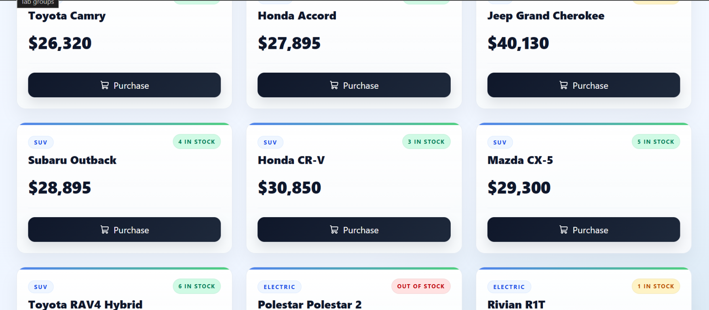

# Dealership Inventory & Management System

A full-stack, enterprise-grade Dealership Inventory Management platform built with Node.js, Express, TypeScript, MySQL, React, and Tailwind CSS.

The system implements Role-Based Access Control (RBAC), atomic transactional inventory management (preventing race conditions during checkout), public vehicle browsing, administrative restock/CRUD controls, and real-time frontend filtering.

---

## Tech Stack & Architecture

- **Frontend:** React 18, TypeScript, Vite, Tailwind CSS, Lucide React icons.
- **Backend:** Node.js, Express, TypeScript, `mysql2/promise` (connection pooling & transactions).
- **Authentication & Security:** JSON Web Tokens (JWT), Bcrypt password hashing, Zod schema validation.
- **Testing & Tooling:** Vitest, Supertest, ESLint, tsx.

---

## Key Features

- **Role-Based Access Control (RBAC):**
  - **Public:** Browse catalog, search vehicles by keyword, filter by category.
  - **Customer:** Authenticate, view real-time stock availability, initiate instant purchases.
  - **Admin:** Create new vehicle listings, restock inventory, delete entries, and supervise counts.
- **Concurrency & Atomic Transactions:**
  - Vehicle purchases and restock actions execute inside explicit MySQL transactions (`START TRANSACTION ... COMMIT`) with row-level locks (`SELECT ... FOR UPDATE`) to eliminate race conditions and overselling.
- **Modern, Responsive UI:**
  - Built with Tailwind CSS, supporting responsive grid views, stock-level badges (Green for in-stock, Amber for low-stock, Red for sold-out), and immediate state reflection without hard refreshes.
- **Automated Database Seeding:**
  - Single-command seed script populating 24 realistic vehicle models across Sedan, SUV, Truck, Electric, and Coupe categories, alongside default test accounts.

---

## Screenshots

### Showroom Inventory



---

## Getting Started Locally

### Prerequisites

Ensure you have the following installed:

- Node.js (v18.x or higher)
- MySQL Server (v8.x or higher)
- Git

### 1. Database Setup

Open your MySQL client (MySQL Workbench, TablePlus, or MySQL CLI):

```sql
CREATE DATABASE dealership_dev;
CREATE DATABASE dealership_test;

USE dealership_dev;

CREATE TABLE IF NOT EXISTS users (
  id INT AUTO_INCREMENT PRIMARY KEY,
  email VARCHAR(255) NOT NULL UNIQUE,
  password VARCHAR(255) NOT NULL,
  role ENUM('CUSTOMER', 'ADMIN') DEFAULT 'CUSTOMER',
  created_at TIMESTAMP DEFAULT CURRENT_TIMESTAMP
);

CREATE TABLE IF NOT EXISTS vehicles (
  id INT AUTO_INCREMENT PRIMARY KEY,
  make VARCHAR(100) NOT NULL,
  model VARCHAR(100) NOT NULL,
  category VARCHAR(50) NOT NULL,
  price DECIMAL(10, 2) NOT NULL,
  quantity INT NOT NULL DEFAULT 0,
  created_at TIMESTAMP DEFAULT CURRENT_TIMESTAMP,
  updated_at TIMESTAMP DEFAULT CURRENT_TIMESTAMP ON UPDATE CURRENT_TIMESTAMP
);
```

### 2. Backend Setup

Navigate to the backend directory:

```bash
cd backend
```

Install dependencies:

```bash
npm install
```

Create a `.env` file in the backend directory (refer to `.env.example`):

```env
PORT=5000
NODE_ENV=development
DB_HOST=localhost
DB_USER=root
DB_PASSWORD=your_mysql_password
DB_NAME=dealership_dev
DB_NAME_TEST=dealership_test
DB_PORT=3306
JWT_SECRET=super_secret_jwt_key_dealership
JWT_EXPIRES_IN=1d
```

Seed the database with default accounts and 24 demo vehicles:

```bash
npm run seed
```

Run the automated integration test suite:

```bash
npm test
```

Start the backend development server:

```bash
npm run dev
```

The backend will be running at `http://localhost:5000`.

### 3. Frontend Setup

Open a new terminal and navigate to the frontend directory:

```bash
cd frontend
```

Install dependencies:

```bash
npm install
```

Run the linter to verify code quality:

```bash
npm run lint
```

Start the Vite dev server:

```bash
npm run dev
```

The application will be live at `http://localhost:5173`.

---

## Deployment: Vercel + Railway

The frontend can be hosted on Vercel, with the Express API and MySQL database hosted on Railway. Deployments use the `main` branch, so push the desired changes to GitHub before connecting the services.

### 1. Deploy the MySQL Database and API on Railway

1. Create a Railway project from this GitHub repository and add a MySQL database.
2. Create a service for the repository and set its **Root Directory** to `backend`.
3. Configure the service to build with `npm run build` and start with `npm start`.
4. Add these variables to the backend service. Use Railway's variable references for the MySQL service values:

   | Variable | Value |
   |---|---|
   | `NODE_ENV` | `production` |
   | `DB_HOST` | MySQL service host |
   | `DB_PORT` | MySQL service port |
   | `DB_USER` | MySQL service username |
   | `DB_PASSWORD` | MySQL service password |
   | `DB_NAME` | MySQL service database name |
   | `JWT_SECRET` | A newly generated, private secret |

5. Connect to the Railway MySQL database and run the table-creation SQL from **Database Setup** above. Do not run `CREATE DATABASE` there; Railway provisions the database for you.
6. Generate a public domain for the backend service. Confirm the API is running by opening `https://<backend-domain>/health`; it should return `{"status":"ok"}`.

### 2. Deploy the Frontend on Vercel

1. Import the same GitHub repository into Vercel.
2. Set the project **Root Directory** to `frontend` and use the `Vite` framework preset.
3. Add this environment variable, replacing the URL with your Railway backend domain:

   ```env
   VITE_API_URL=https://<backend-domain>/api
   ```

4. Deploy the project and copy its public Vercel URL.
5. In Railway, set the backend service's `CORS_ORIGIN` variable to that exact Vercel origin (for example, `https://your-project.vercel.app`, with no trailing slash), then redeploy the backend.

### 3. Initialize Inventory and Admin Access

- Register a customer account through the deployed site.
- To grant that account admin privileges, run this query against the Railway database, replacing the email with your account's email:

  ```sql
  UPDATE users SET role = 'ADMIN' WHERE email = 'your-admin-email@example.com';
  ```

- Log out and back in to refresh the account's role in its authentication token.
- The backend seed script deletes existing vehicle rows before inserting demo inventory. Only run `npm run seed` against a dedicated, empty database whose vehicle data can be safely replaced.

Keep database credentials and JWT secrets in Railway's private environment variables. Never commit production secrets or put them in Vercel's `VITE_*` variables.

### Pre-Configured Test Credentials

After running `npm run seed`, the following testing accounts are immediately available:

| Role | Email | Password | Access Privileges |
|---|---|---|---|
| Admin | `customer@test.com` | `Password123!` | Add vehicle, restock, delete vehicle, supervisor view |
| Customer | Register any new account | Any valid password | Browse catalog, checkout, atomic stock deduction |

---

## Testing the User Flows

### Sign Up & Customer Purchasing

1. Click **Sign In** and switch to **Register**.
2. Create an account (e.g., `buyer@dealership.com` / `Password123!`).
3. Notice customer permissions (CUSTOMER badge in navbar; no delete or restock controls).
4. Purchase a vehicle and verify the quantity decrements atomically.

### Admin Operations

1. Log in using the pre-seeded admin credentials: `customer@test.com` / `Password123!`.
2. Confirm the ADMIN badge appears in the navigation bar.
3. Test admin privileges: **+ Add Vehicle**, **Restock**, and **Delete**.

---

## My AI Usage

### 1. AI Tools Used

- **Google Gemini:** Used for primary architectural design, debugging runtime setup issues, and validating core implementation workflows.
- **ChatGPT:** Used to cross-check structural patterns, verify system recommendations, and assist with boilerplate code and standard queries.
- **GitHub Copilot:** Used inline in the IDE for quick autocompletion, TypeScript interface templates, and repetitive syntax.

### 2. How the Tools Were Used

#### Multi-Model Cross-Verification for Architectural Decisions

A major part of my workflow involved using a cross-verification technique. When faced with critical structural decisions—such as designing role-based route protection (public vs. authenticated inventory viewing), organizing the layered Express/TypeScript folder architecture, and structuring database connection pooling—I prompted one AI for an approach and deliberately cross-verified the proposed solution with another AI. Comparing both perspectives allowed me to catch architectural trade-offs, avoid anti-patterns, and choose the most robust design.

#### Cross-Checking Implementation Details

Beyond high-level decisions, I applied this cross-verification method to smaller, practical tasks—including refining SQL queries, validating TypeScript interface contracts, and tuning configuration options—to confirm best practices.

#### Concurrency & Atomic Transaction Design

Consulted AI to verify explicit MySQL transaction patterns (`START TRANSACTION`, row-level locking via `SELECT ... FOR UPDATE`, and atomic decrement checks) inside vehicle purchase and restock controllers to prevent race conditions.

#### Debugging & Framework Configuration

Used AI assistance to diagnose frontend build hurdles, such as resolving runtime module import errors caused by `isolatedModules: true` by switching to explicit `import type` syntax, as well as fixing Tailwind CSS v4 Vite integration directives.

#### Seed Dataset Preparation

Generated a realistic, 24-vehicle demo dataset with diverse categories, price tiers, and inventory states (in stock, low stock, and sold out) to test search and category filters immediately on startup.

### 3. Reflection on AI Impact on Workflow

Using AI with an intentional cross-verification method substantially improved the quality of the project:

- **Better Decision-Making:** Cross-checking structural choices across multiple AI models prevented over-reliance on a single set of assumptions and forced me to critically evaluate architectural options before writing code.
- **Accelerated Debugging & Learning:** Instead of trial-and-error troubleshooting for modern tooling quirks (like Vite build rules or Tailwind setup changes), targeted inquiries surfaced the exact root causes in minutes.
- **Focus on Core Logic & Quality:** Automating seed creation and boilerplates freed up time and mental bandwidth to concentrate on backend transaction safety, security boundaries, and smooth user interactions.
